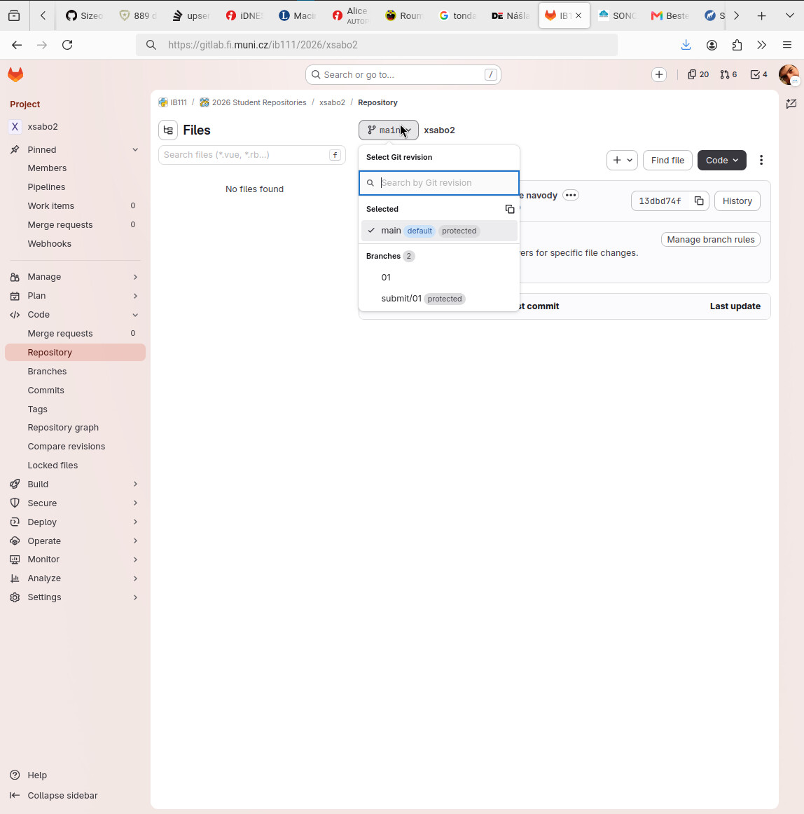
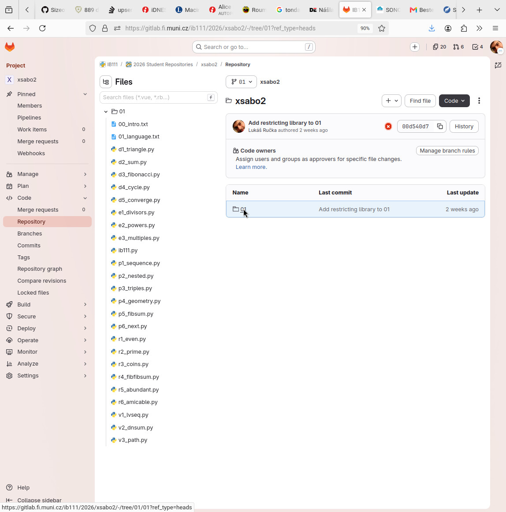
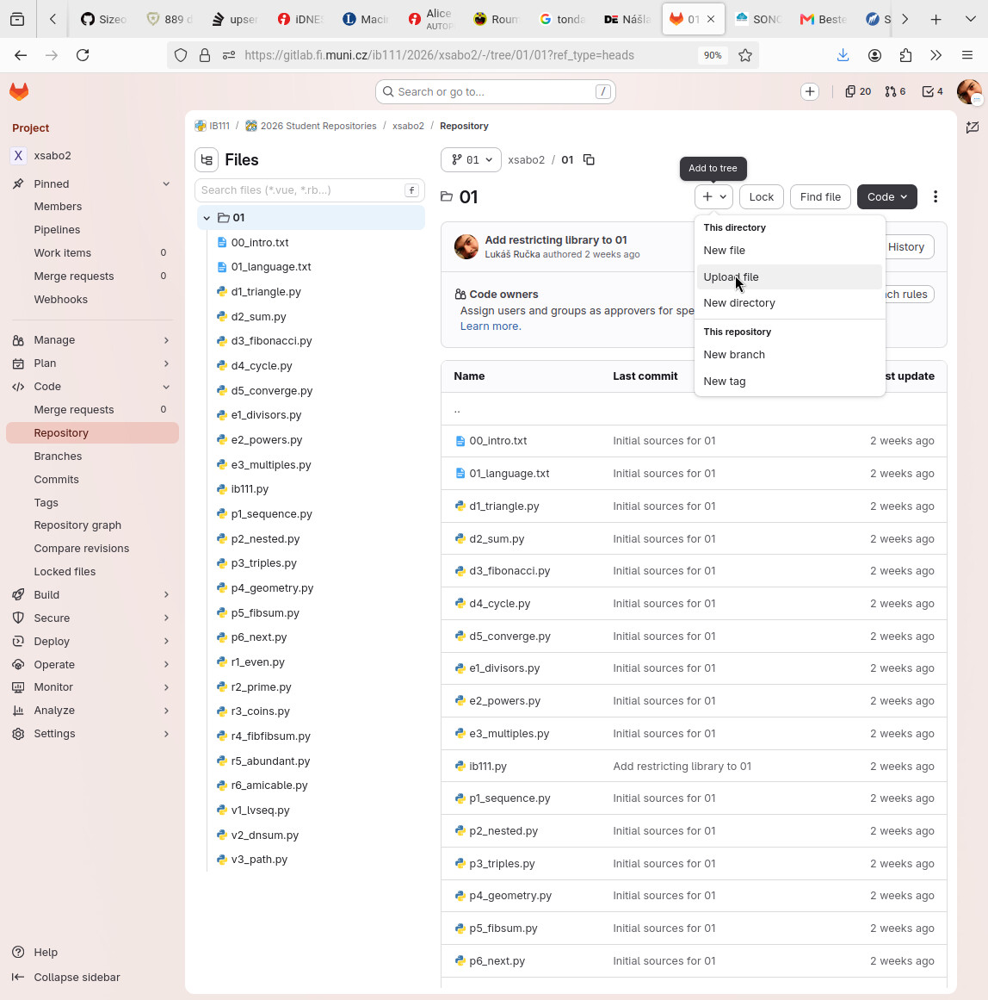
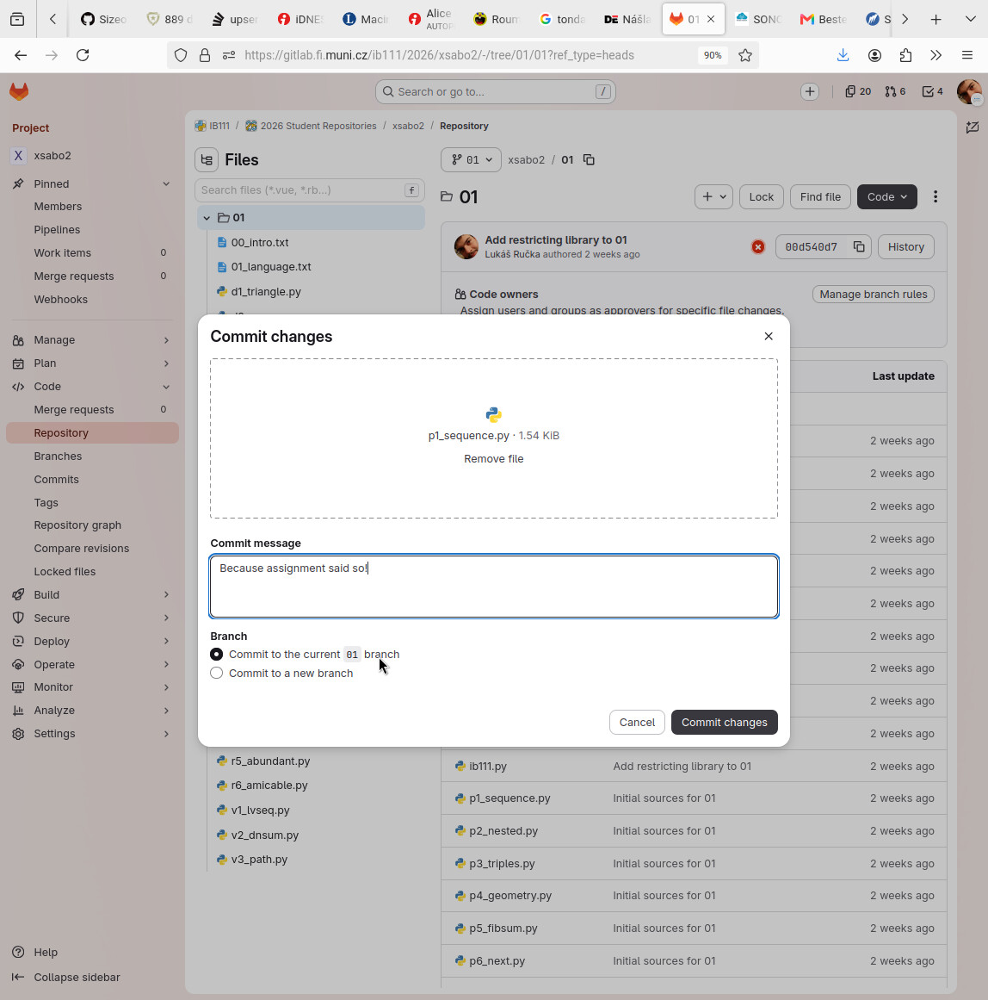

# Pracovní repozitář pro IB111

V tomto repozitáři budete postupně vypracovávat jednotlivé (průběžné) přípravy.
Platí, že jednotlivé úlohy jsou vždy řazeny do adresáře s číslem týdne na který se __připravujete__.

Tento adresář je navíc umístěn do větve s identickým názvem.
Analogické schéma je užito i pro odevzdávání sad příkladů, pokrývajících jednotlivé bloky. 

Vlastní obrázkový návod k odevzdávání je níže, pro zbylé informace zde nepokryté neváhejte otevřít organizační pokyny, či se případně zeptat na předmětovém diskusním fóru.

## Návod k odevzdání příprav

Nejprve je nutné přepnout se do správné větve.

- Větve s krátkými názvy (01, s1, ...) slouží k vypracování úloh.
- Větev main bude obsahovat případné publikované aktualizace organizačních pokynů (nemusí být aktuální).

V sekci **Repository → Files** klikněte na tlačítko s názvem aktuální větve (např. `main`) a v rozbalovací nabídce vyberte větev (zadání), do které chcete vypracovanou úlohu nahrát (např. `01`).
Následně se přesuňte do potřebného podadresáře.

Nyní můžete nahrát svou implementaci - klikněte na tlačítko **+** (Add to tree) a z nabídky vyberte **Upload file**.
Pozor! Samotné nahrání souboru musíte doplnit (stručným) zdůvodněním, bez tohoto se vám změny neuloží (Tlačítko **Commit changes**).

Po dokončení se soubor objeví v repozitáři ve zvolené větvi a složce -- toto si ověřte.
